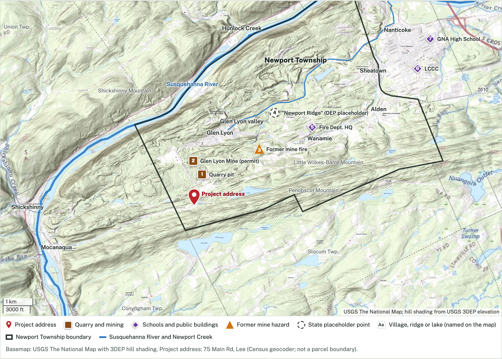

# Newport Township Site Atlas

Interactive map of the proposed Fit Energy fuel cell and data center project in Newport Township, Luzerne County, Pennsylvania, with the area's anthracite mining history (Susquehanna Coal Co., Glen Lyon).

**Live map:** https://aar2dee2.github.io/newport-township-map/

## What's on the map
- The one project address officials have given (75 Main Rd, Lee section), placed with the U.S. Census geocoder. The project's 1,386-acre boundary is not public, so this is an address point, not a parcel.
- Newport Township and neighboring municipalities, the Susquehanna River and Newport Creek, villages, ridges and lakes.
- Historic underground mine workings by operator (Susquehanna Coal Co. and others) and abandoned-mine hazard areas from PA DEP. These layers are off by default.
- Overlays: the 1894 USGS Shickshinny topographic sheet and a Susquehanna Coal Co. surface map of the Glen Lyon Colliery (PA Mine Map Atlas).

## Sources
- Basemaps and hill shading: USGS The National Map (USGSTopo, USGSImageryOnly) and USGS 3DEP elevation.
- Place names: USGS Geographic Names Information System.
- Address points: U.S. Census Bureau Geocoder.
- Boundaries, mined areas, abandoned-mine inventory, mining permits: PA DEP eMapPA.
- "Newport Ridge Data Center" point: PA DEP Data Center Permit Tracker (location marked by DEP as not yet submitted).
- Historical maps: USGS Historical Topographic Map Collection; Pennsylvania Mine Map Atlas (Penn State PASDA / PA DEP).
- Site address and ownership: Times Leader, Oct 5, 2026. Zoning permits: Newport Township Board of Commissioners minutes, Sept 8, 2026.

Feature locations were checked against the Census Bureau's municipal boundaries and USGS elevation data on Oct 7, 2026.

## Screenshots
- [Newport Township](screenshots/1-newport-township.png)
- [Project site close-up](screenshots/2-project-site-closeup.png)
- [Region and Susquehanna River](screenshots/3-region-susquehanna-river.png)
- [Newport Township on the 1894 USGS map](screenshots/4-newport-township-on-1894-usgs-map.png)
